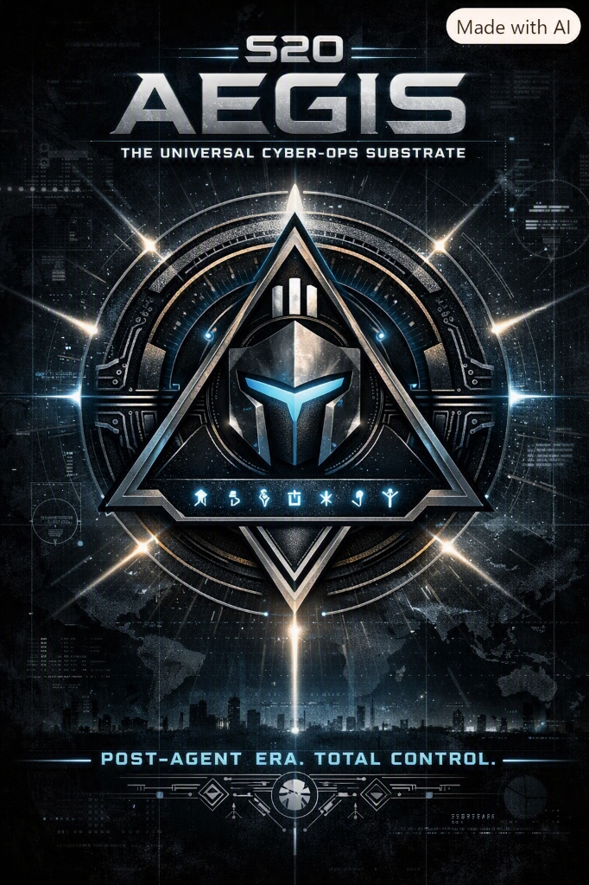

<p align="center">
  
</p>

# S2O AEGIS: The Universal Cyber-Ops Substrate

[](https://www.rust-lang.org)
[](#the-9-pillars-of-aegis)
[](NOTICE)

> **Status: pre-release.** Aegis is under active development. The table below
> marks each pillar **Working**, **Partial** or **Planned** based on what the
> code does today, not on the roadmap. Most features are Windows-first.

---

## Why Aegis Exists

The enterprise endpoint-security landscape is fractured:
* **Kernel-driver fragility**: heavy kernel-mode agents can take down whole fleets when they fail.
* **The multi-agent tax**: organizations run 5 to 7 disconnected agents, each with its own console, telemetry and resource cost.
* **Black-box agents**: closed agents are hard to audit and send telemetry to third-party clouds.

**S2O Aegis aims to be a single, auditable, open-core agent and console for fleet security and observation**, engineered from the ground up in Rust. It runs in **userspace by default** (no paid driver-signing costs), using OS-native tools such as `netsh`/NetSecurity cmdlets, Microsoft Defender, `netstat`/procfs and Cloudflare DNS-over-HTTPS.

For deep packet inspection, Aegis has a **pluggable packet-backend port** (`PacketBackend` in `crates/s2o-platform`). The default build ships a `NoDriver` backend; an optional `packet-driver` feature reserves the slot for WinDivert or a future CA-signed custom driver. The driver binding itself is **Planned**.

---

## The 9 Pillars of Aegis

| # | Pillar | Crate / binary | Status | What works today | Not yet |
| :---: | :--- | :--- | :---: | :--- | :--- |
| I | **S2O Cyberwall** (firewall) | `cyberwall-*`, `cyberwall` | **Working** (Windows) / **Partial** (Linux) | Windows: enable/disable firewall, outbound "airplane" block, list/add/delete rules via `netsh` and NetSecurity cmdlets. Linux: status probe only. | Declarative `apply_policy` (all OSes); Linux rule control; macOS |
| II | **S2O CyberMesh** (overlay VPN) | `cybermesh` | **Partial** | Real X25519 WireGuard keypairs; writes WireGuard config files; local peer list | Bringing tunnels up, peer exchange, any network control plane |
| III | **S2O CyberDefender** (antivirus) | `cyberdefender` | **Working** (Windows) | On-demand recursive SHA-256 scan against a small built-in hash list; Microsoft Defender status, quick scan and signature update via MpCmdRun | Own real-time protection; large signature sets |
| IV | **S2O CyberEDR** (process & socket telemetry) | `cyberedr` | **Working** | TCP socket table with owner PIDs (Windows `netstat -ano`, Linux `/proc`), suspicious-port flags, polling watcher that logs new sockets | Process lineage, kill policies, kernel telemetry |
| V | **S2O CyberSIEM** (event log) | `cybersiem`, `s2o-store` | **Working** (local) | Append-only JSONL store at `.aegis/events.jsonl`; query/filter/tail/export | Central collection across a fleet; syslog forwarding |
| VI | **S2O CyberIntel** (threat intel) | `cyberintel` | **Working** (on demand) | Pulls the Abuse.ch URLhaus recent feed into a local JSON DB; lookups | Scheduled sync, more feeds, sharing across hosts |
| VII | **S2O CyberDNS** (DNS shield) | `cyberdns` | **Partial** | DoH lookups via Cloudflare; local blocklist; `cyberdns serve` UDP forwarder | Running as a system resolver/service; verified sinkholing of all host DNS |
| VIII | **S2O CyberID** (device posture) | `cyberid` | **Working** (Windows) | 4-check posture score (firewall 30, Defender 30, UAC 20, SecureBoot 20); Ed25519-signed tokens with `verify` | Central authority / key distribution; FIDO2/IAM integration |
| IX | **S2O CyberZTNA** (access gateway) | `cyberztna` | **Planned** | Stores route definitions; runs a local posture preflight | The proxy itself, mTLS, enforcement |

Supporting crates: `aegisd` (daemon: probes firewall/Defender/sockets, writes a health event, serves `ping`/`status` over local IPC; `reload` is not implemented), `aegis-cli` (`aegis` multiplexer), `s2o-bus` (IPC), `s2o-schema` (event schema), `s2o-platform` (OS integration + packet-backend port).

---

## Architecture: The Universal Substrate

1. **OS backends behind traits**:
   * **Windows**: userspace `netsh` / PowerShell NetSecurity / Defender today → optional kernel packet driver later (**Planned**).
   * **Linux**: firewall status probe and `/proc` socket telemetry today; nftables control and eBPF (**Planned**).
   * **macOS**: **Planned** (no backend yet).
2. **Local IPC**:
   * **Windows**: Named Pipe (`\\.\pipe\s2o_aegis_ipc`).
   * **Unix**: Unix Domain Socket (`/tmp/s2o_aegis.sock`).
   * JSON request/response protocol between `aegis` and `aegisd`.
3. **Userspace by default**: the default build loads no kernel driver of its own.

---

## Executive Command Center GUI

`aegis-gui` is an `egui` dashboard showing each pillar with its real status (LIVE / ON DEMAND / KEYS ONLY / NOT IMPLEMENTED), firewall rule management, Defender scan triggers, socket view and the local event stream. Several buttons currently shell out to `cargo run -p <crate>`, so the GUI is a **developer build** today.

```powershell
cargo run --bin aegis-gui
```

---

## Building

```sh
cargo check --workspace          # builds on Windows and Linux; no system OpenSSL needed
cargo test --workspace
```

Most runtime features need Windows and an elevated shell.

---

## Master Multiplexer CLI (`aegis`)

Control every aspect of Aegis through a single master binary:

```powershell
# Platform, OS and firewall backend status
aegis status

# Zero-Trust posture audit (4 checks)
aegis posture

# Firewall control (Windows)
aegis firewall enable
aegis firewall block-port 4444 --protocol TCP
aegis firewall block-ip 198.51.100.1
aegis firewall list

# Filesystem Malware & Integrity Scanning
aegis scan C:\Windows\System32

# DNS-over-HTTPS lookup and local blocklist
aegis dns resolve zv9games.org
aegis dns block malicious-c2.com

# EDR Process & Socket Telemetry
aegis edr sockets
aegis edr audit

# Inter-Process Daemon Communication
aegis daemon ping
aegis daemon status
```

---

## Licensing

S2O Aegis is **dual-licensed** by Split2ops Software:

### 1. Community Edition: AGPL-3.0-only
* Free and open source; full text in [LICENSE](LICENSE), copyright and terms in [NOTICE](NOTICE).
* The source is auditable, so you can check for yourself what telemetry the agent sends.
* Network-use copyleft: if you modify Aegis and offer it as a service, you share those modifications.

### 2. Commercial License
For organizations that need to distribute or embed Aegis without AGPL obligations (MSPs, OEM/appliance vendors, enterprise fleets). Planned commercial offerings include an SLA, a signed custom packet driver and fleet orchestration; these are **not available yet**.

📧 **Commercial inquiries:** [enterprise@zv9games.org](mailto:enterprise@zv9games.org)

---

<p align="center">
  <b>S2O Aegis</b> by Split2ops Software · <a href="https://zv9games.org">zv9games.org</a><br/>
  <i>Copyright © 2026 Split2ops Software. Licensed under AGPL-3.0-only or a commercial license.</i>
</p>
